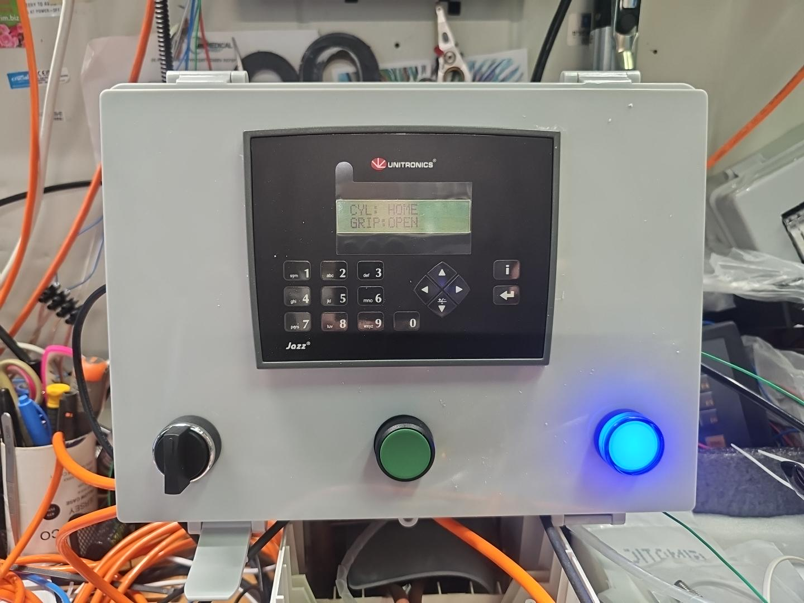

# MOLD GRIPPER V2 — V3.0

**Статус: ЗАВЕРШЁН · РАБОЧАЯ ВЕРСИЯ · ПРОВЕРЕНА НА ОБОРУДОВАНИИ**

Проект автоматического управления пневматическими цилиндрами и захватами (grippers) для работы с пресс-формой.

- **Контроллер:** Unitronics Jazz JZ20-R16.
- **Программирование:** U90 Ladder, язык релейно-контактных схем (**Ladder Logic / LD**).
- **Оборудование:** в установке используется **Emetronix**.
- **Актуальная программа:** [V3.0.U90](V3.0.U90).
- **Результат:** автоматический цикл, пневматика, START/RESET, настройки таймеров и переходы HMI проверены на реальной установке.

## Принцип работы

После команды START контроллер выполняет последовательность с контролем датчиков положения:

1. Проверяет исходное положение цилиндров и захватов.
2. Выполняет стартовую задержку.
3. Выдвигает цилиндры.
4. Закрывает захваты.
5. Выдерживает заданные задержки.
6. Возвращает цилиндры с захваченными деталями.
7. Открывает захваты.
8. Формирует сигнал завершения цикла для оборудования.

Последовательность реализована в Ladder Logic с шагами состояния и контролем входных сигналов.

## Подключение PLC

### Дискретные входы

| Вход | Сигнал |
| --- | --- |
| I0 | GRIP 1–4 OPEN |
| I1 | GRIP 5–8 OPEN |
| I2 | GRIP 1–4 CLOSE |
| I3 | GRIP 5–8 CLOSE |
| I4 | CYL FRONT |
| I5 | CYL BACK |
| I6 | START PULSE |
| I7 | RESET |

**Примечание:** на этапе наладки сигналы I1 и I3 проверялись с дублирующими перемычками от I0 и I2 соответственно. Перед изменением проводки сверяйтесь с фактической схемой установки.

### Дискретные выходы

| Выход | Назначение |
| --- | --- |
| O0 | CYL EXTEND — выдвижение цилиндров |
| O1 | GRIP CLOSE — закрытие захватов |
| O2 | CYCLE DONE — импульс завершения цикла |

## Логика и переменные

- `MI0 CURRENT_STEP` — текущий шаг автоматического цикла.
- `MI1 ERROR_CODE` — регистр кода ошибки.
- `MB0 HOME_OK` — признак исходного положения по датчикам.
- Команды START и RESET проверены, включая повторный запуск и сброс.

## Таймеры

Все четыре настройки проверены на панели оператора и в работе установки.

| Таймер | Название на HMI | Назначение |
| --- | --- | --- |
| T6 | START DELAY | Задержка перед началом |
| T10 | GRIP DELAY | Задержка захватов |
| T7 | GRIP HOLD | Выдержка захватов |
| T8 | SHAKE TIME | Время встряхивания |

## Панель HMI

### Готовый пульт управления — V3.0

*Пульт управления после завершения сборки и испытаний. На экране: CYL: HOME / GRIP: OPEN.*

| Экран | Назначение |
| --- | --- |
| Display 1 | Hi — приветствие |
| Display 2 | Status — состояния цилиндров и захватов |
| Display 3 | START DELAY (T6) |
| Display 4 | Grip Delay (T10) |
| Display 5 | GRIP HOLD (T7) |
| Display 6 | SHAKE TIME (T8) |

Проверены редактирование значений таймеров с клавиатуры, подтверждение изменений и переходы между экранами.

## Итоги испытаний

**Проверено и работает:**
- Пневматические цилиндры и захваты.
- Полный автоматический цикл.
- Привязка и регулировка таймеров.
- Индикация и навигация HMI.
- START, RESET и повторный запуск.
- Работа цикла на реальном оборудовании.

**Открытых задач по версии V3.0 нет.** Счётчик продукции не требуется и **не планируется**.

## Файлы проекта

- [`V3.0.U90`](V3.0.U90) — актуальный проект U90 Ladder. Файл открывается в среде U90 Ladder; GitHub не отображает его Ladder-схемы непосредственно в браузере.
- [`image-1793622238317.jpg`](image-1793622238317.jpg) — фотография готового пульта управления.

## Важное замечание

V3.0 зафиксирована как проверенная рабочая версия. Перед любыми последующими изменениями сохраняйте отдельную копию. Любые изменения пневматики, проводки, PLC или алгоритма требуют повторной проверки на оборудовании с соблюдением правил промышленной безопасности.

---

**MOLD GRIPPER V2 · V3.0 · PROJECT COMPLETED · 02.11.2026**
